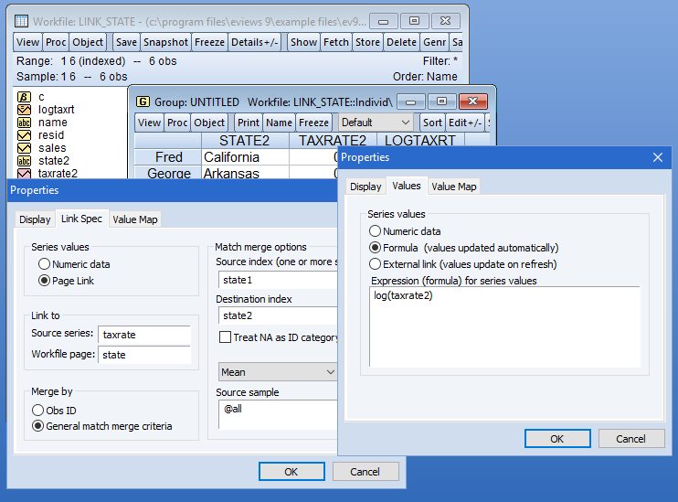
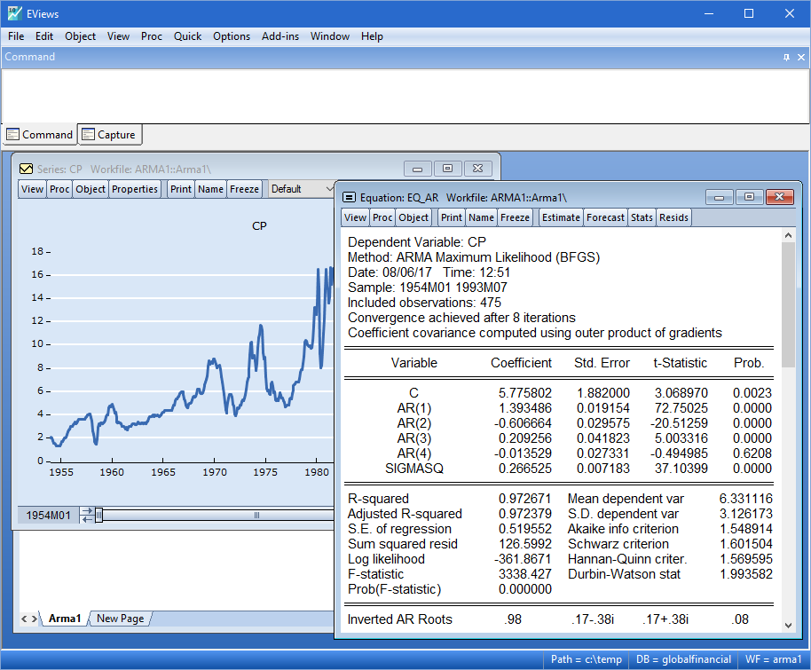

# EViews Time Series Models With Explicit Forecast Boundaries

Use eviews software to keep dated observations, estimated equations, and forecast series together.
A reproducible EViews analysis records which data were available, which observations estimated the model, and which dates were reserved for evaluation.

[](https://eviews-software.github.io/eviews-econometric-software/)

## Give every observation an unambiguous identity

Before fitting an equation in eviews econometric software, inspect the active workfile page.
The page structure establishes how observations are identified and how dated operations are interpreted.

| Data structure | Observation identity | Example of an ambiguity to resolve |
| --- | --- | --- |
| Quarterly time series | One quarter per observation | Calendar quarter versus fiscal quarter |
| Monthly time series | One month per observation | Observation month versus publication month |
| Cross-section | One entity or record identifier | Duplicate identifiers after a merge |
| Dated panel | Entity identifier plus period | Repeated entity-period pairs or missing periods |

Keep different source frequencies on clearly identified pages when appropriate.
EViews documents [multi-page workfiles](https://www.eviews.com/help/content/workfile-Multi-page_Workfiles.html) for organizing datasets and working across pages.

Specify the conversion rule before combining monthly and quarterly observations.
A sum, an average, and an end-of-period value represent different quantities.

For imported observations, retain:

- Source and retrieval date.
- Units and any scaling applied.
- Seasonal-adjustment status.
- The meaning of blanks and other missing-value codes.
- Whether values are preliminary, revised, or from a historical vintage.

Current revised data may support a retrospective comparison.
A real-time forecasting claim also requires the information available at the stated forecast origin.



## Keep the estimation sample visible

In eviews statistical software, the workfile range and the active sample serve different purposes.
Write the estimation dates into the program so that a later interface action cannot silently redefine the intended analysis.

The EViews commands below assume an active quarterly page covering at least 1999Q4 through 2024Q4.
The page must already contain the numeric series y_actual with the required observations.
The dates and object names are illustrative.

```eviews
smpl 2000q1 2019q4
equation ar_base.ls y_actual c y_actual(-1)
show ar_base
```

This estimates an intercept and one lag of the dependent variable.
Check the equation's reported estimation sample and usable observation count, especially when missing values occur.

The [sample command reference](https://www.eviews.com/help/content/commandcmd.html) explains how smpl controls statistical operations.
Keep the lag specification, transformations, and covariance choice with the equation record.

### Investigate the series before interpreting persistence

Plot the series and consider whether levels, differences, trends, or breaks are relevant to the economic question.
For a unit-root test, record the deterministic terms, lag rule, sample, and null hypothesis.

EViews' [unit-root documentation](https://eviews.com/help/content/advtimeser-Unit_Root_Testing.html) distinguishes the tests and their assumptions.
A residual-based cointegration procedure requires its appropriate reference distribution.

The supplied files are examples and documentation from the independent arch package, rather than EViews application source.
They provide method comparisons; the Python package's implementation code is absent from this snapshot.

Compare arch's [unitroot_examples.ipynb](examples/unitroot_examples.ipynb) with its test reference, [tests.rst](doc/source/unitroot/tests.rst).
For long-run relationships, [unitroot_cointegration_examples.ipynb](examples/unitroot_cointegration_examples.ipynb) accompanies [cointegration.rst](doc/source/unitroot/cointegration.rst).

These references help distinguish hypotheses and procedures.
They do not establish that differently configured implementations must return identical results.

## Generate forecasts from a named equation

Make the forecast origin and horizon explicit in an eviews data analysis record.
For the previously estimated ar_base equation, the next block uses the reserved period without re-estimating its coefficients.

```eviews
smpl 2020q1 2024q4
ar_base.forecast y_dynamic y_dynamic_se
smpl @all
```

The generated series are named separately from the observed target.
The final command restores the full active sample; it does not change the fitted coefficients.

EViews' [equation forecast procedure](https://www.eviews.com/help/content/equationcmd-forecast.html) documents dynamic forecasts and optional standard-error output.
For a lagged dependent variable, distinguish recursive multi-step forecasts from static predictions that use observed lagged outcomes.

### State which future inputs are known

A forecast with exogenous regressors needs values for those regressors over the horizon.
Separate genuinely known inputs from assumed scenarios and observations revealed after the forecast origin.

The arch notebook [univariate_forecasting_with_exogenous_variables.ipynb](examples/univariate_forecasting_with_exogenous_variables.ipynb) illustrates this dependency.
Its [univariate_volatility_scenarios.ipynb](examples/univariate_volatility_scenarios.ipynb) shows how explicit shock assumptions define a scenario.

For volatility forecasts, compare [univariate_volatility_forecasting.ipynb](examples/univariate_volatility_forecasting.ipynb) with the methods described in [forecasting.rst](doc/source/univariate/forecasting.rst).
The associated result-object reference is [results.rst](doc/source/univariate/results.rst).

Keep scenario output labeled by the assumptions used to produce it.
An assumed future path and an unconditional forecast answer different questions.



## Score the same dates on the same scale

Evaluate candidates against a common benchmark over matching target periods.
Record whether the exercise uses one fixed origin or repeated forecast origins.

For an independent check, prepare forecast_check.csv with date, actual, and forecast columns.
Use ISO dates representing quarter starts, one row per quarter, and values on the same scale.
This external Python example uses pandas to calculate RMSE over the illustrative holdout period.

```python
import pandas as pd

frame = pd.read_csv("forecast_check.csv", parse_dates=["date"]).set_index("date").sort_index()
if not frame.index.is_unique:
    raise ValueError("Duplicate evaluation dates")
scored = frame.loc["2020-01-01":"2024-12-31", ["actual", "forecast"]].dropna()
if scored.empty:
    raise ValueError("No complete evaluation pairs")
error = scored["actual"] - scored["forecast"]
print({"n": len(scored), "rmse": float((error.pow(2).mean()) ** 0.5)})
```

Report the number and identity of scored dates alongside the loss.
Missing forecast-target pairs can otherwise give different models different evaluation samples.

If an equation models a transformation, define the evaluation scale before comparing errors.
A log-scale error and an original-unit error are different measures.

For comparisons across many candidates, arch provides [multiple-comparison_examples.ipynb](examples/multiple-comparison_examples.ipynb).
Its [multiple-comparison-reference.rst](doc/source/multiple-comparison/multiple-comparison-reference.rst) describes procedures including superior predictive ability and model confidence sets.

Keep the benchmark and loss definition attached to any comparison.
Searching many models and reporting only the smallest observed error requires a different interpretation from evaluating a prespecified model.

## Separate the predicted mean from uncertainty

An equation for the conditional mean and a model for changing variance describe different aspects of a series.
Label each reported forecast by the quantity it predicts.

### Identify the modeled quantity

For a volatility study in EViews, record the mean specification, variance specification, innovation distribution, and data scaling.
Inspect convergence information and relevant residual diagnostics before using the fitted result.

The arch material makes those components explicit:

- [mean.rst](doc/source/univariate/mean.rst) describes mean-model choices.
- [volatility.rst](doc/source/univariate/volatility.rst) describes variance processes.
- [distribution.rst](doc/source/univariate/distribution.rst) describes innovation distributions.

The worked [univariate_volatility_modeling.ipynb](examples/univariate_volatility_modeling.ipynb) combines these ideas.
[univariate_using_fixed_variance.ipynb](examples/univariate_using_fixed_variance.ipynb) illustrates a separate fixed-variance workflow.

Use these as comparative references while retaining the actual EViews specification and output.
A variance forecast should not be evaluated as though it were a forecast of the series level.

### Preserve the interval construction

State whether an interval concerns a coefficient, a conditional mean, or a future observation.
Include the confidence level and the assumptions used to calculate it.

For dependence-aware resampling, compare arch's [bootstrap_examples.ipynb](examples/bootstrap_examples.ipynb) with [timeseries-bootstraps.rst](doc/source/bootstrap/timeseries-bootstraps.rst).
Alternative interval constructions are documented in [confidence-intervals.rst](doc/source/bootstrap/confidence-intervals.rst).
Long-run covariance methods are listed separately in [covariance.rst](doc/source/covariance/covariance.rst).

Choose a method that matches the dependence and stationarity assumptions of the analysis.
Keep interval uncertainty distinct from the uncertainty created by a hypothetical future scenario.

When reproducing an EViews 14 study, retain the exact installed build and required add-ins.
The version label alone does not identify the data vintage, equation specification, or forecast information set.

Save the workfile and program with a short record of page names, sample boundaries, transformations, and evaluation dates.
Those details make it possible to trace a published forecast back to the observations and assumptions that produced it.

## Related Search Terms

eviews software, eviews econometric software, eviews statistical software, eviews data analysis, eviews 14, econometrics, time-series, panel-data, forecasting, regression, statistics, unit-root, garch, bootstrap, data-analysis
